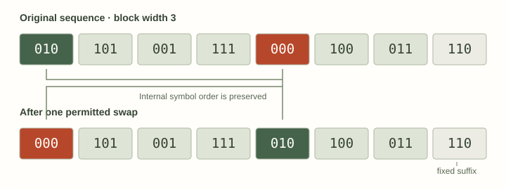

# The EMC-like shuffle measure

The function `emc()` asks a practical question: **how does the LZ complexity change when blocks of a sequence are rearranged at several scales?** It returns a shuffle-based magnitude qualitatively similar to effective measure complexity (EMC).

The historical API name is retained. This is not an exact numerical EMC or excess-entropy estimator. Its calculation uses the same sequence, factorization engine and block-swap method described here; it does not fit a model of the source.

## The intuition

A completely rearranged sequence retains its symbols but changes their organization. Rearranging larger blocks keeps the order *inside* each block while disrupting relationships *between* blocks. Repeating that experiment at several block sizes gives a view of how the observed organization responds to those interventions.

The surrogate is finite. New joins are introduced, some original structure may survive, and the algorithm makes a finite series of swaps. “Shuffle at scale `l`” therefore describes a particular intervention, not a proof that all and only correlations longer than `l` have been removed.

## The calculation, step by step

Let `N` be the input byte length, `C` its LZ76 factor count, `b` the logarithm base and `M` the maximum block size.

1. **Count the original.** Compute `C` once.
2. **Make one surrogate for each scale.** At each `l = 1…M`, start from a fresh original copy, swap aligned blocks, and factorize the result to obtain `C_l`.
3. **Compute the raw contrast.** Use the same length normalization as entropy density, with the existing scale multiplier:

    ```text
    g   = log_b(N) / N
    r_l = l · g · (C_l - C)
    ```

4. **Fit the scale profile.** Find the nonnegative, nondecreasing profile `f_1…f_M` minimizing the sum of squared differences from `r_1…r_M`. The implementation uses pool-adjacent-violators isotonic regression, then clips negative fitted values to zero.
5. **Report the final fitted value and increments.** Set `f_0 = 0`:

    ```text
    score                 = f_M
    summands[l - 1]       = f_l - f_(l-1)
    multi_information     = r_1
    ```

The raw first-scale contrast is exposed in `lz76()` under its legacy `multi_information` name. It can be negative. It is not the first fitted summand and is not calibrated Shannon mutual information.

### What fitting does

For an illustrative raw profile `[3, 2, 4]`, the first decrease is pooled to give `[2.5, 2.5, 4]`. The fitted increments are `[2.5, 0, 1.5]` and the returned score is `4`.

A zero increment can therefore mean that neighboring scales were pooled; it need not mean that no structure exists at that scale. The nonnegative increments and their sum are consequences of the fitting rule, not evidence that each increment is a conditional-entropy contribution.

## What “random block shuffle” means here

The implementation performs `floor(N/2)` iterations per scale. Each iteration chooses two distinct, non-overlapping blocks aligned at multiples of `l` and swaps them, preserving order inside each block.



*One swap illustrated on 24 bytes. A full surrogate uses 12 swap iterations; the diagram shows the operation, not a complete surrogate.*

A seed derived from the input's FNV-1a hash and the scale initializes `ChaCha8`. The exact `rand` and `rand_chacha` dependency versions are pinned because their sampling behavior affects results. There is one surrogate per scale, with no user seed parameter or independent surrogate averaging in this API.

The finite swap process is not a uniform draw from every possible block permutation. A legacy boundary convention also leaves the suffix beginning at `floor((N - 1)/l) · l` fixed for nonempty input. At least the final byte remains unchanged. If `N` is divisible by `l`, the entire last block remains fixed.

Inputs of at most ten bytes are unchanged by shuffling. A scale with fewer than two eligible blocks is also unchanged. The [compact implementation definition](../shuffle-measure.md) records these conventions together.

## Calling it

```python
import lzcomplexity as lz

sequence = "00010111" * 256
value, summands = lz.emc(sequence, log_base=2, max_block_size=8)
assert value >= 0
assert all(term >= 0 for term in summands)
assert abs(sum(summands) - value) < 1e-12
```

Use `lz.lz76(sequence, ...)` when you also need `h`, factor boundaries, the actual maximum block size and the raw `multi_information` diagnostic. The full call reuses the original factorization.

A positive `max_block_size` specifies `M`. Nonpositive values use the length-based helper approximating `N = M · 2^M`, with ten added for `N > 50`. This is an implemented scale-selection convention, not a convergence guarantee. The base-two cutoff heuristic does not automatically adapt to a larger alphabet.

## Why a constant sequence scores zero

Every rearrangement of `0000…` is the same sequence. Its surrogate and original factor counts are equal at every scale, so every raw contrast is zero.

That result says the pattern is unaffected by block shuffling. It does not say that a constant sequence lacks an obvious pattern. This is a specific contrast measure, not a universal count of all possible kinds of structure.

## What to compare

Match input length, encoding, logarithm base and block-size cap. Examine sensitivity to the chosen length and cap rather than relying on one scalar. A periodic pattern can be preserved by some block sizes and disrupted by others, making block alignment relevant.

Identical calls are reproducible, but a symbol relabeling or cyclic shift changes the content-derived seed and may change the surrogate score. Repeat calls on identical bytes are not independent observations and cannot supply an uncertainty interval.

Base-two normalization is a unit convention; it does not make this a calibrated shared-information bit count. A larger finite score does not universally imply a larger theoretical EMC. Finite-sample parsing, new block joins, incomplete mixing, the fixed suffix and fitting all contribute to the reported result.

## Relation to theoretical EMC

For a stationary process, let `H(L)` be block entropy, `h` entropy rate and `h_L = H(L) - H(L-1)` the conditional uncertainty added by the next symbol. The theoretical reference is

```text
E = sum_{L≥1}(h_L - h) = lim_{L→∞}[H(L) - L · h]
```

When the relevant expressions are well defined, this is also the information shared between semi-infinite past and future. These are source-level quantities, rather than the finite shuffle calculation above. [Grassberger (1986)](https://doi.org/10.1007/BF00668821) and [Crutchfield and Feldman (2003)](https://doi.org/10.1063/1.1530990) provide the conceptual background.

Shuffle-based analyses in [Melchert and Hartmann (2015)](https://doi.org/10.1103/PhysRevE.91.023306) and [Estevez-Rams et al. (2019)](https://doi.org/10.1371/journal.pone.0214863) motivate the qualitative comparison. A reference to that literature is not a claim that this finite implementation is mathematically identical to theoretical excess entropy.

**Next:** [reading the returned fields](../guide/reading-the-numbers.md), [length sensitivity](convergence.md), or [Python API](../api/python.md).
