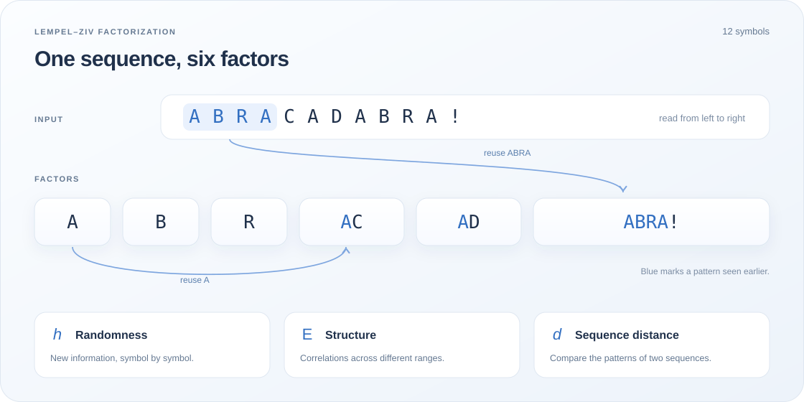

<section class="lz-hero">

PLEROS / SCIENTIFIC COMPUTING

<h1>Lempel–Ziv sequence analysis.</h1>

Measure randomness, correlations across scales and similarity in symbolic data.

<strong>lzcomplexity</strong> brings entropy density, effective measure complexity and information distance to Python, Rust and standalone command-line tools.

<a class="lz-button lz-button-primary" href="guide/">Get started →</a><a class="lz-text-link" href="#try-it">Try it in your browser ↓</a>

<code>pip install lzcomplexity</code><button type="button" data-copy="pip install lzcomplexity" aria-label="Copy installation command">Copy ⧉</button>

Open source · MIT licensed · Python + Rust

<figure class="lz-hero-figure" aria-label="LZ76 factorization of a binary sequence">
<picture><source media="(max-width: 600px)" srcset="assets/sequence-workflow-mobile.svg"></picture>
<figcaption><a href="guide/first-factorization/">Read the factorization example ↗</a></figcaption>
</figure>
</section>

<nav class="lz-section-nav" aria-label="On this page">Explore lzcomplexity<a href="#measures">The measures</a><a href="#try-it">Playground</a><a href="#applications">Applications</a><a href="#documentation">Documentation ↗</a></nav>

<section class="lz-section lz-measures" id="measures">

THE MEASURES
<h2>Randomness, structure and similarity.</h2>
Use h to study the production of new information, E to examine organization across ranges, and d to compare sequences.
<a class="lz-text-link" href="guide/reading-the-numbers/">Learn to interpret the results →</a>

<a class="lz-measure" href="concepts/entropy-density/">h
ENTROPY DENSITY<h3>How random is it?</h3>
Captures how much new information a sequence produces: its unpredictability and freedom to vary. In language and creative processes, this can reflect innovation within a context.

↗</a>
<a class="lz-measure" href="concepts/emc/">E
EFFECTIVE MEASURE COMPLEXITY<h3>How structured it is?</h3>
Sensitive to correlations across different ranges and levels of organization. In text, think of the context carried by letters, words and longer passages.

↗</a>
<a class="lz-measure" href="concepts/nid/">d
INFORMATION DISTANCE<h3>How different are they?</h3>
Derived from Normalized Information Distance (NID), d compares the patterns shared by two sequences. Use it to compare recordings, texts or symbolic trajectories.

↗</a>

</section>

<section class="lz-lab" id="try-it" aria-labelledby="lz-lab-title">

INTERACTIVE PLAYGROUND
<h2 id="lz-lab-title">Explore your own sequences.</h2>
Paste a sequence, choose an example and explore what changes.

● Runs on your device

<button type="button" id="lz-tab-parse" role="tab" aria-selected="true" aria-controls="lz-panel-parse" data-mode="parse">Factors &amp; h</button><button type="button" id="lz-tab-structure" role="tab" aria-selected="false" aria-controls="lz-panel-structure" data-mode="structure" tabindex="-1">Complexity E</button><button type="button" id="lz-tab-distance" role="tab" aria-selected="false" aria-controls="lz-panel-distance" data-mode="distance" tabindex="-1">Distance d</button>

<label for="lz-input" id="lz-input-label">Your sequence</label>6 / 256 bytes

<textarea id="lz-input" rows="4" maxlength="256" spellcheck="false" autocomplete="off" aria-describedby="lz-limit lz-input-error">banana</textarea>

<label for="lz-input-b">Sequence B</label>6 / 256 bytes
<textarea id="lz-input-b" rows="4" maxlength="256" spellcheck="false" autocomplete="off" aria-describedby="lz-limit lz-input-error">banaba</textarea>

Examples<button type="button" data-example="banana">banana</button><button type="button" data-example="periodic">Periodic</button><button type="button" data-example="irregular">Irregular</button><button type="button" data-example="constant">Constant</button><button type="button" data-example="dna">DNA</button>

<button class="lz-button lz-button-primary" type="button" id="lz-analyze">Analyze sequence →</button>Each input is limited to 256 UTF-8 bytes.

Start with banana to see the factor boundaries, or try a longer example to explore E.

Ready to analyze your new sequence.

Factorization<a href="guide/first-factorization/" aria-label="Read the factorization guide">About this result ↗</a>

banana

<strong id="lz-demo-count">3</strong>LZ76 count

<strong id="lz-demo-h">1.2925</strong>Entropy density h · base 2

The final copied tail is excluded from the reported count. Short-sequence estimates of h can exceed one.

Effective measure complexity<a href="concepts/emc/">About E ↗</a>

<strong id="lz-demo-e">—</strong>Effective measure complexity E

<strong id="lz-demo-range">—</strong>Range examined · bytes

<svg class="lz-curve" id="lz-e-chart" viewBox="0 0 480 180" role="img" aria-label="E profile across ranges"><text x="240" y="90" text-anchor="middle">Choose an example to see its scale profile.</text></svg>

The scale profile shows the fitted score as the examined range increases.

Sequence comparison<a href="concepts/nid/">About distance ↗</a>

<strong id="lz-demo-distance">—</strong>Information distance · from NID

A lower d indicates more shared patterns. Compare sequences with the same encoding and similar lengths.

UTF-8 byte analysis · base-two logarithms · <a href="guide/quick-reference/">Python cheatsheet ↗</a>

<noscript>
Enable JavaScript to use the playground, or <a href="guide/install/">install the Python library</a> to analyze sequences locally.
</noscript>
</section>

<section class="lz-section lz-get-started">

PYTHON, RUST AND THE COMMAND LINE
<h2>Analyze a sequence. Compare a collection.</h2>
Factor a sequence, estimate its entropy density, explore effective measure complexity and compare it with another sequence. One Rust core powers all three interfaces.

<a href="api/python/">Python library ↗</a><a href="cli/">Standalone binaries ↗</a><a href="api/rust/">Rust library ↗</a>

<i></i><i></i><i></i>analysis.py<button type="button" data-copy="import lzcomplexity as lz&#10;&#10;sequence = &quot;00010111&quot; * 256&#10;result = lz.lz76(sequence, log_base=2, max_block_size=16)&#10;&#10;print(result[&quot;h&quot;])&#10;print(result[&quot;emc&quot;][&quot;value&quot;])&#10;print(lz.nid(sequence, &quot;01010101&quot; * 256))" aria-label="Copy Python example">Copy ⧉</button>
<pre><code>import lzcomplexity as lz

sequence = "00010111" * 256
result = lz.lz76(
    sequence,
    log_base=2,
    max_block_size=16,
)

print(result["h"])
print(result["emc"]["value"])
print(lz.nid(sequence, "01010101" * 256))</code></pre>
pip install lzcomplexity Python ≥ 3.9

</section>

<section class="lz-applications" id="applications">

FROM SYMBOLS TO SCIENCE
<h2>Research applications.</h2>
Use symbolic representations to study information in experimental signals, biological sequences and nonlinear dynamics.

<a class="lz-recipe" href="recipes/neuro/"><svg viewBox="0 0 300 100" aria-hidden="true"><path d="M0 51H24L30 42 36 62 42 21 48 82 54 40 60 56 66 48H104L110 39 116 70 122 18 128 79 134 39 140 56 146 49H185L191 44 197 64 203 25 209 75 215 40 221 56 227 51H300"/></svg><h3>Neural time series</h3>
Choose a threshold, build a binary sequence and compare matched windows.
Read the recipe ↗</a>
<a class="lz-recipe" href="recipes/genomics/">
A C <i>G</i> T A C G <i>T</i> T <i>G</i> C A T G <i>C</i> A G C A <i>T</i> G <i>C</i> A T
<h3>Genomic sequences</h3>
Read FASTA, handle ambiguous bases and make encoding choices explicit.
Read the recipe ↗</a>
<a class="lz-recipe" href="recipes/dynamical-systems/"><svg viewBox="0 0 300 100" aria-hidden="true"><path d="M12 85Q30 15 48 75T84 60 120 68 156 30 192 65 228 12 264 73 300 29"/><path d="M12 85Q45 10 78 56T144 38 210 54 276 20" opacity=".3"/></svg><h3>Dynamical systems</h3>
Symbolize a trajectory and examine its transition from regular to chaotic behavior.
Read the recipe ↗</a>

THE RESEARCH
Explore <a href="https://doi.org/10.1371/journal.pone.0214863">organization in written language</a>, <a href="https://doi.org/10.1063/1.5062364">computation at the edge of chaos</a> and <a href="https://doi.org/10.1103/PhysRevE.107.044212">complexity in coupled oscillators</a>.
<a href="project/references/">All references ↗</a>

</section>

<section class="lz-documentation-banner" id="documentation">

DOCUMENTATION
<h2>Guides and API reference.</h2>
Installation, worked examples, detailed function and command references, and compact usage cheatsheets.

<a href="guide/">Read the documentation →</a><a href="api/python/">Python function reference →</a><a href="cli/">Standalone binaries →</a><a href="guide/quick-reference/">Usage cheatsheets →</a>
</section>
<footer class="lz-home-footer"><strong>lzcomplexity</strong> by Pleros<a href="project/authors/">Authors &amp; citation</a><a href="https://github.com/pleros-ai/lzcomplexity">GitHub ↗</a></footer>

